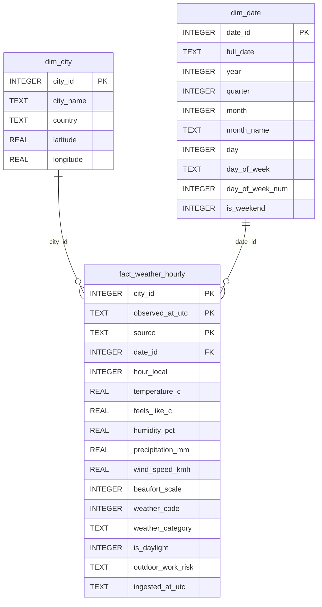

# ERD: WeatherFlow star schema

## Grain

One row per city, per hour, per source.

## Diagram

## Design notes

- **Primary key** of the fact table is (city_id, observed_at_utc, source). `source` is in the key because a second weather source will be added next week.
- **date_id** is the London (local) date from `observed_at_local`, because the business plans by UK calendar day. A reading at 23:30 UTC on 30 June belongs to 1 July in London.
- **city_id** is a surrogate key assigned in `dim_city` during the load. Upserts keep it stable.
- **Idempotent load:** facts use `INSERT ... ON CONFLICT DO UPDATE`, and the whole load runs in one transaction, so a failure leaves no partial rows.