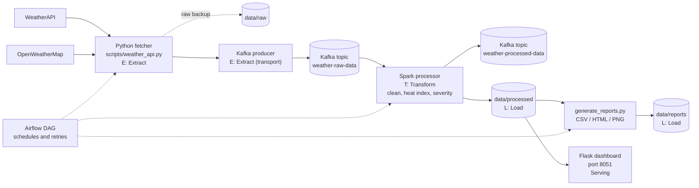

# Reference Architecture: WeatherFlow-DataEngineering

Data flow from weather APIs to the dashboard. **E** = Extract, **T** = Transform, **L** = Load.
Built from README.md and IMPLEMENTATION.md; some edges are inferred from the docs.

| Stage | Label |
|---|---|
| Fetch from APIs, publish to Kafka | E |
| Spark cleaning and derived metrics | T |
| Write to data/processed and data/reports | L |
| Dashboard reads stored data | Serving (after L) |
